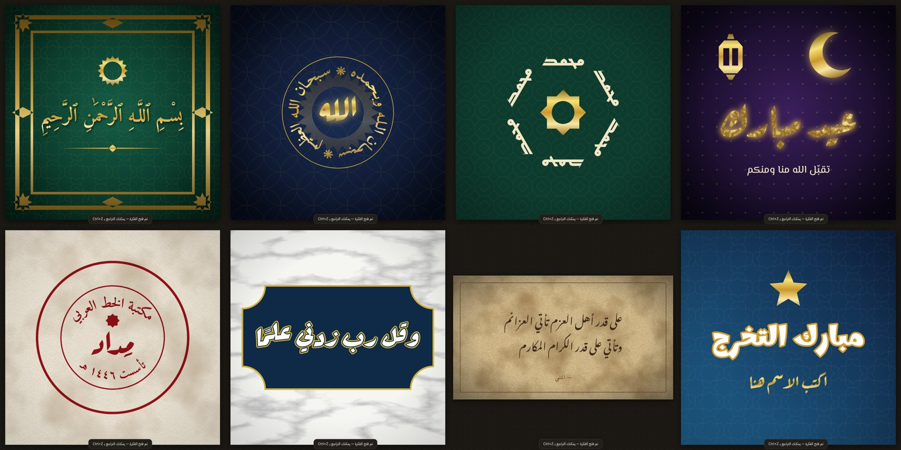
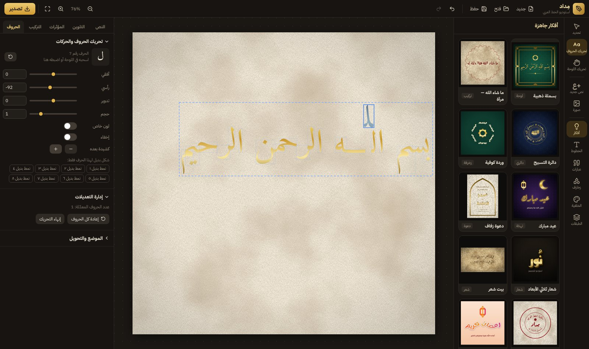

# مِداد — استوديو الخط العربي

برنامج تصميم خط عربي يعمل في المتصفح ودون إنترنت. يشكّل النص بمحرك **HarfBuzz** (المحرك نفسه الذي تستخدمه المتصفحات وأنظمة التشغيل)، فكل حرف وحركة شكلٌ مستقل يمكن تحريكه وتلوينه وتغيير شكله.





## التشغيل

```bash
cd midad
npm install
npm run dev        # http://localhost:5173
npm run build      # نسخة الإنتاج في dist/ — ملفات ثابتة تعمل على أي استضافة
```

## الأدوات

| الأداة | ما تفعله |
|---|---|
| **54 خطًا عربيًا** | نسخ، ثلث وعرض، رقعة، ديواني، نستعليق، كوفي، مغربي، زخرفي، حديث — مضمّنة محليًا برخص مفتوحة (OFL وما يماثلها) |
| **استيراد خطوطك** | أي ملف TTF/OTF من جهازك يعمل كخط كامل (تحريك الحروف، الكشيدة، البدائل، التصدير)، ويُحفظ في المتصفح (IndexedDB) فقط |
| **تحريك الحروف** | انقر أي حرف أو حركة واسحبها؛ تدوير وتكبير ولون خاص وإخفاء لكل حرف |
| **الكشيدة** | تلقائية (موزّعة على المواضع الصحيحة)، يدوية بعد أي حرف متصل، وضبط الأسطر بالكشيدة |
| **البدائل الأسلوبية** | أشكال بديلة يوفّرها الخط (ss01…، salt، swsh) — على كل النص أو على حرف واحد |
| **التشكيل** | لوحة حركات ورموز خاصة (ﷲ ﷺ ﷽ ۞ ﴾﴿) تُدرج عند المؤشر |
| **التراكيب** | سطر، قوس، دائرة كاملة، موجة، مرآة (مثنّى)، انعكاس، وردة متكررة — مع ثني حقيقي للحروف يحافظ على الاتصال |
| **التلوين** | لون، تدرجات (ذهبي، فضي، نحاسي…)، خامات (رخام، رقائق ذهب، خشب)، حدّان داخلي وخارجي |
| **المؤثرات** | ظل، توهج، بروز ثلاثي الأبعاد، شفافية، أنماط دمج (ضرب كالحبر على الورق) |
| **الزخارف** | إطار مزخرف، محراب، خرطوشة، شمسة، ميدالية، خاتم ثماني، نجوم، وردة، هلال، فانوس، فاصل، نقطة… |
| **الخلفيات** | ألوان وتدرجات، خامات ورق (رَق، قديم، كرافت، كتّان، رخام، إبرو)، نقوش هندسية إسلامية، تظليل أطراف |
| **أفكار جاهزة** | 16 تصميمًا قابلًا للتعديل: بسملة، دائرة تسبيح، وردة كوفية، ختم، دعوة زفاف، تهاني الأعياد… |
| **عبارات** | آيات وأذكار، تهاني، حكم وأبيات شعر — بنقرة |
| **التصدير** | PNG حتى ×4 (بخلفية شفافة اختياريًا)، JPG، **SVG متجه** (الحروف مسارات تُفتح في Illustrator)، وملف مشروع `.midad.json` |

حفظ تلقائي في المتصفح (`localStorage`)، تراجع وإعادة، طبقات، قفل وإخفاء، محاذاة مع خطوط إرشاد، تكبير وتحريك (ويدعم اللمس).

## الاختصارات

| | |
|---|---|
| `V` / `L` / `H` | تحديد / تحريك الحروف / تحريك اللوحة |
| `Ctrl+Z` / `Ctrl+Y` | تراجع / إعادة |
| `Ctrl+C` / `Ctrl+V` / `Ctrl+D` | نسخ / لصق / تكرار |
| `Delete` | حذف العنصر (أو إخفاء الحرف المحدد في وضع الحروف) |
| الأسهم (`Shift` ×10) | تحريك دقيق للعنصر أو للحرف |
| `Ctrl` + العجلة، `+` / `-` / `0` | تكبير، تصغير، ملاءمة |
| `Space` + سحب | تحريك اللوحة |
| `Ctrl+S` | حفظ ملف المشروع |

## البنية

```
src/engine/hb.ts        تحميل الخطوط في HarfBuzz، التشكيل، ثنائية الاتجاه، تحويل المسارات وثنيها
src/engine/layout.ts    تخطيط النص: الأسطر، المحاذاة، الكشيدة، تعديل الحروف، التراكيب
src/engine/userFonts.ts الخطوط المستوردة من جهاز المستخدم (IndexedDB)
src/engine/kashida.ts   مواضع الكشيدة وإدراجها وإعادة ترقيم التعديلات عند تحرير النص
src/engine/export.ts    التصدير PNG/JPG/SVG والمشروع
src/components/render.tsx  رسم المستند SVG (مشترك بين المحرر والتصدير)
src/components/Stage.tsx   اللوحة: التحديد والسحب والتحجيم والتدوير ووضع الحروف
src/data/               الخطوط، الأشكال، الألوان، العبارات، الأفكار الجاهزة
src/panels/             لوحات الخصائص والمكتبات والتصدير
public/fonts/           ملفات الخطوط (مقتطعة للعربية واللاتينية الأساسية) وتراخيصها
```

## إضافة خط

للاستخدام الشخصي: زر «استيراد خط من جهازك» في مكتبة الخطوط — لا يحتاج تعديل الكود.

لتضمين خط في البرنامج نفسه (يجب أن تسمح رخصته بإعادة التوزيع — لا تُضمَّن الخطوط التجارية المنشورة دون إذن أصحابها):

1. ضع ملف `.ttf` في `public/fonts/` (يُفضّل اقتطاعه بـ `pyftsubset` مع `--layout-features='*'` حتى لا تضيع البدائل والتراكيب).
2. أضف سطرًا في `src/data/fonts.ts` بالمعرّف والاسم والتصنيف، و`variable` إن كان الخط متغير الوزن.

## الرخص

الخطوط من Google Fonts ومن مستودعات مؤلفيها برخصة SIL OFL 1.1 (عدا «تنها» و«ناهيد» برخصة مشتقة من Bitstream Vera) — انظر `public/fonts/LICENSES-OFL.txt`. محرك HarfBuzz برخصة MIT.
